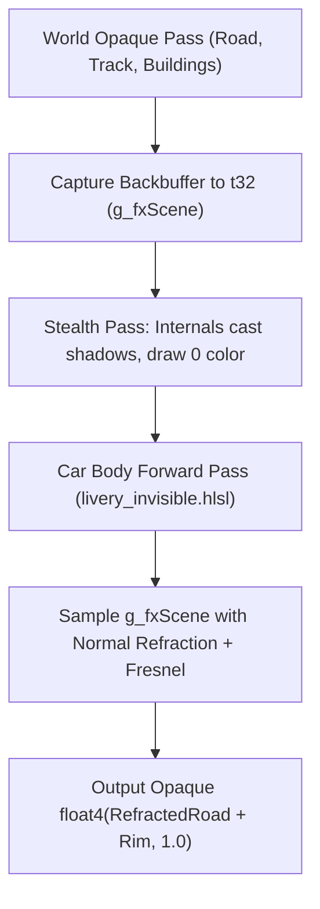

# CarX Drift Racing Online 2 — Render Pipeline & Transparency Reverse Engineering

> **Authoritative Technical Document for URUSHI / CarFX**  
> **Target:** CarX Drift Racing Online 2 (Unity 6000.3.19f1, Universal Render Pipeline / URP, Forward+, DX11 x64, IL2CPP)  
> **Purpose:** Comprehensive reference for graphics reverse engineering, vehicle rendering architecture, material/shader internals, depth prepass, render queues, and proper implementation of transparency, glass, refraction, and ghosting.

---

## 1. High-Level Engine & Graphics Architecture

| Parameter | Value / Detail |
|---|---|
| **Engine Version** | Unity **6000.3.19f1** (Unity 6) |
| **Scripting Backend** | **IL2CPP** (`GameAssembly.dll` + `UnityPlayer.dll`) |
| **Native Game Core** | `NativeCarX.dll` (physics, wheel simulation, car state) |
| **Graphics API** | **DirectX 11** (`d3d11.dll`, `dxgi.dll`) |
| **Render Pipeline** | **Universal Render Pipeline (URP)** with Forward+ path and SRP Batcher enabled |
| **Depth Prepass** | Active (`DepthOnly` pass executed for opaque geometry) |
| **Shadow Pipeline** | Cascaded Shadow Maps via `ScriptableRenderLoopShadowsJob` / `RenderShadowCasterPartsSRPBatcher` |

---

## 2. Vehicle Hierarchy & Geometry Decomposition

In CarX DR2, a vehicle is **not** a single monolithic mesh. When spawned on track, a vehicle consists of a complex `GameObject` hierarchy containing dozens of distinct renderers grouped by role:

```
CarRoot (GameObject)
 ├── Model (GameObject)
 │    ├── car_body(Clone) [14-16 separate MeshRenderers]
 │    │    ├── Hood, Trunk, Roof
 │    │    ├── Front/Rear Bumpers, Fenders, Doors, Side Skirts
 │    │    └── Spoiler / Aero Kit
 │    ├── car_glass [MeshRenderers] (Windshield, Rear, Sides)
 │    ├── car_stock_frame [MeshRenderer] (Unibody / chassis shell)
 │    ├── Internals / Mechanical Components [~140+ MeshRenderers]
 │    │    ├── Engine (Block, intake manifold, turbo/supercharger, intercooler pipes, exhaust)
 │    │    ├── Drivetrain (Transmission bellhousing, propshaft, rear diff, half-shafts)
 │    │    ├── Suspension (FL/FR/RL/RR upper & lower arms, subframes, knuckle, tie rods)
 │    │    ├── Coilovers (Springs, shock bodies, top hats)
 │    │    └── Brakes (Discs, calipers - separate transforms for steer/rotation)
 │    ├── Interior / Cabin [MeshRenderers]
 │    │    ├── Bucket seats, Dashboard, Steering wheel, Shifter, Handbrake
 │    │    └── Rollcage (tubing)
 │    └── Wheels [4 Wheel GameObjects]
 │         ├── Wheel_FL, Wheel_FR, Wheel_RL, Wheel_RR (Rim + Tyre)
```

### 2.1 The Livery / Decal System (`VinylBaker`)
* **No Decal Geometry:** CarX DR2 does **not** draw liveries using floating quad meshes or secondary decal geometry.
* **Baked Texture Atlas:** All stickers, vinyls, layers, and sponsor decals are baked on the GPU by `VinylSystem` / `VinylBaker` into a single **2048x2048 dynamic 2D texture** (`u_sTexture` atlas).
* **Channel Packing:**
  * `.rgb` = Decal RGB color.
  * `.a` = Decal coverage mask (`1.0` = decal covers body paint, `0.0` = naked base paint).
* In CarFX, this baked livery atlas is tapped and bound to `register(t38)` (`g_fxLivery`).

---

## 3. Shader Architecture & Draw Call Signatures

### 3.1 Primary Shaders
* **Car Body Paint:** Shader `RenderCore/Standard` with sub-variant `MAT_CAR_PAINT_3_0`.
* **Car Glass:** Standard transparent glass shader (`car_glass`, Queue ~2600).
* **Decal Overlays:** Baked into diffuse or composite pass.

### 3.2 Vertex-to-Pixel Input Signature (`PSIn`)
The Forward pass vertex shader outputs the following exact register layout:

```hlsl
struct PSIn {
    float2 uv        : TEXCOORD20;   // v0.xy  : mesh UV0 (shared with baked livery UV)
    float  vcolW     : TEXCOORD21;   // v0.z   : vertex COLOR.w
    float  vcolX     : TEXCOORD22;   // v0.w   : vertex COLOR.x
    float3 posRelCam : TEXCOORD0;    // v1.xyz : worldPos - cameraPos (camera-relative position)
    float3 normalW   : TEXCOORD1;    // v2.xyz : world-space surface normal
    float4 tangentW  : TEXCOORD2;    // v3.xyzw: world-space tangent (xyz) + handedness sign (w)
    float4 svpos     : SV_Position;  // v4.xy  : screen-space pixel position (0.5 .. width-0.5, height-0.5)
};
```

### 3.3 Constant Buffer Bindings (Game vs CarFX)
* `register(b0)` .. `register(b5)`: Camera matrices, View/Projection, Screen dimensions, Directional lights, Shadows.
* `register(b6)` (`UnityPerMaterial`):
  * `g_carColor` (`u_vColor`): Primary base paint color.
  * `g_carSecondaryColor` (`u_vSecondaryColor`): Secondary accent color.
  * `g_carThirdColor` (`u_vThirdColor`): Pearlescent / flake color.
  * `g_carParams`, `g_carParams1`, `g_carParams2` (`u_fParams`): Smoothness, Metallic, Clearcoat, Flake strength.
* `register(b11)`: Unity SRP Batcher per-draw object buffer.
* **`register(b13)` (Injected by CarFX):** Host telemetry buffer (unused by game):
  * `g_fxTime`: Current run time, delta time, draw index, target ID.
  * `g_fxScreen`: Screen resolution, inverse viewport dimensions.
  * `g_fxParam[8]`: Custom shader parameters (`p0`..`p7`).
  * `g_fxCarPos`, `g_fxCarRight`, `g_fxCarUp`, `g_fxCarFwd`: Car coordinate frame in world space.
  * `g_fxCamPos`, `g_fxCamRight`, `g_fxCamUp`, `g_fxCamFwd`: Main camera coordinate frame.
  * `g_fxDriftState`: Absolute drift angle (°), signed drift angle (°), normalized angle (0..1), speed (km/h).
  * `g_fxWall*`: 10-point wall/barrier raycast telemetry (gaps in meters + surface hit normals).
  * `g_fxNearCar*`: 3D Oriented Bounding Box (OBB) telemetry of nearest opponent/tandem car.

---

## 4. Unity 6000.3 Internal Memory Offsets & Native RVAs

All RVAs are relative to `UnityPlayer.dll` (base address `unityBase`):

### 4.1 Native Function Offsets
```cpp
// Unity 6000.3.19f1 internal entry points
InstanceIDToObject:                   unityBase + 0x107480  // (const int32_t* id) -> void* nativeObject
Material::GetRenderQueue:             unityBase + 0x095eb0  // (void* natMat) -> int32_t
Material::SetRenderQueue:             unityBase + 0x095ef0  // (void* natMat, int32_t rq) -> void
Material::SetShaderPassEnabled:       unityBase + 0x098530  // (void* natMat, const UnityManagedSpanWrapper* name, bool enabled) -> void
Renderer::GetOrAssignInstantiatedMat: unityBase + 0x47aa00  // (void* natRenderer, int32_t slotIdx) -> void* natMat
Renderer::SetMaterial (Slot 0):       unityBase + 0x08ce50  // (void* natRenderer, void* natMat) -> void
Renderer::SetMaterialAt (VTable):     vtable[0x100 / 8]     // (void* natRenderer, const int32_t* pMatId, uint32_t slotIdx)
```

### 4.2 GameObject & Component Memory Layout
```
GameObject (Native Pointer):
  +0x20 : Pointer to Component Array (ComponentEntry*)
  +0x30 : Component Count (uint32_t)

ComponentEntry:
  +0x00 : ClassID (uint32_t)  --> 107 = MeshRenderer, 110 = SkinnedMeshRenderer
  +0x08 : Native Pointer to Component

MeshRenderer / SkinnedMeshRenderer (Native Pointer):
  +0x08 : InstanceID (int32_t)
  +0x140: Pointer to Material InstanceID Array (int32_t*)
  +0x150: Material Count (uint32_t)

Material (Native Pointer):
  +0x08 : Material InstanceID (negative = instantiated clone, positive = shared asset)
  +0x20 : Pointer to Material Name (const char*)  e.g. "car_body(Clone)"
```

---

## 5. The Depth Prepass & The Naive Transparency Trap

### 5.1 Why Naive Alpha Blending Fails Completely
In Unity URP Forward+, rendering proceeds in discrete passes:
1. **Depth Prepass (`DepthOnly` pass):**
   * All opaque materials (default queue `2000..2499`, `car_body` is at `2200`) are drawn into the Z-buffer *before* any color shading happens.
   * A stripped-down vertex shader outputs `SV_Position`, and the hardware writes the depth value to the active `DepthStencilView`.
2. **Forward Color Pass:**
   * Opaque objects are rendered front-to-back.
   * Early-Z test (`DepthFunc = LESS_EQUAL`) compares pixel depth against the prepass depth buffer.
   * Hardware blend state for opaque objects is disabled: `BlendEnable = FALSE`, writing full color (`RenderTargetWriteMask = 0x0F`).

### 5.2 The Failure Modes of Naive Pixel Shaders:
* **Attempt 1: Returning `float4(color.rgb, 0.5)` in pixel shader:**
  * **Result:** The car remains **100% opaque**! The render target blend state is `BlendEnable = FALSE`, so the alpha channel is ignored or written into the target buffer without blending over background pixels.
* **Attempt 2: Forcing D3D11 Alpha Blend State during Forward pass without modifying Unity:**
  * **Result:** **Black or missing background silhouette.** Because the car body *already wrote depth* during the `DepthOnly` prepass, the background road geometry behind the car was either already discarded by Early-Z or never rendered into that region. The semi-transparent pixels blend with whatever uninitialized or clear color exists in the backbuffer!
* **Attempt 3: Discarding pixels (`clip(-1)` or `alpha discard`):**
  * **Result:** A "hole" through the car showing either the skybox or background, but with depth artifacts and broken shadow silhouettes because the depth prepass did not know the pixels would be discarded (unless Alpha-to-Coverage / Cutout is explicitly set up).

---

## 6. How Proper Transparency & Refraction Work in URUSHI

To achieve true, artifact-free transparency, two distinct problems must be solved:
1. **The Depth & Queue Pipeline:** Preventing the car from prematurely writing depth and moving it behind the background world geometry.
2. **The "Internal Geometry" Dilemma:** Handling the engine, gearbox, frame, and interior parts that sit inside the transparent shell.

---

### 6.1 Solution 1: Optical Screen-Space Refraction (The "Glass / Predator Cloak" Approach)
*Used in `shaders/livery_invisible.hlsl`.*

This is the cleanest, most performant approach for single-car transparency and optical camouflage.



#### Step-by-Step Implementation:
1. **Backbuffer Scene Capture:**
   Right before the player's car body begins its Forward pass, CarFX captures the current backbuffer color into a dedicated texture `g_fxScene` (`register(t32)`):
   ```cpp
   context->CopySubresourceRegion(m_sceneCopyTex, 0, 0, 0, 0, backBufferTex, 0, &box);
   ```
2. **Hiding Internal Geometry (`@stealth 1`):**
   * If the car body is transparent, you would normally see the opaque engine, rollcage, transmission, and suspension.
   * With `@stealth 1`, URUSHI traverses all ~140 child renderers of the car and swaps their material slots with a **shadow-only proxy material**.
   * **Crucial benefit:** The car's internal parts still cast realistic shadows onto the road and under the chassis, but they **emit zero color** into the main color buffer.
   * Therefore, the captured `g_fxScene` snapshot contains the **clean, uninterrupted road and background**.
3. **Refractive Lens Shader (`livery_invisible.hlsl`):**
   The pixel shader calculates a screen-space refraction offset based on the surface normal and viewing angle:
   ```hlsl
   float2 screenOffset = ScreenNormal(i) * (bendPx * scale * (0.2 + 0.8 * edge));
   
   // Chromatic dispersion (prism RGB split)
   float3 seen;
   seen.r = SceneAtSafe(i, screenOffset * (1.0 + disp)).r;
   seen.g = SceneAtSafe(i, screenOffset).g;
   seen.b = SceneAtSafe(i, screenOffset * (1.0 - disp)).b;
   
   // Add Fresnel rim lighting + grazing sky reflections
   float3 col = seen * tint + envSpec + rimColor * edge;
   
   // Optional: preserve vinyl decals on the glass surface
   if (keepLivery > 0.0) {
       float4 liv = Livery(i);
       col = lerp(col, liv.rgb, liv.a * keepLivery);
   }
   return float4(col, 1.0); // Opaque output, perfectly blended!
   ```

---

### 6.2 Solution 2: True Hardware Alpha Blending (URP Transparent Queue)
*Used for ghost cars, holographic overlays, and multi-vehicle transparency.*

To make the car truly transparent using GPU alpha blending (`SrcAlpha + InvSrcAlpha`), the Unity material state **must** be reconfigured at runtime:

#### Step 1: Disable the Depth Prepass on the Material
Call native `Material::SetShaderPassEnabled` to disable the `"DepthOnly"` pass on `car_body(Clone)`:
```cpp
const auto pfnSetPass = reinterpret_cast<t_UP_MatSetShaderPassEnabled>(unityBase + 0x098530);
static const wchar_t kDepthOnlyW[] = L"DepthOnly";
const UnityManagedSpanWrapper depthOnlySpan{ kDepthOnlyW, 9 };

pfnSetPass(natMat, &depthOnlySpan, false);
```
*Result:* The vehicle will no longer write depth during the prepass.

#### Step 2: Move the Render Queue to Transparent
Call native `Material::SetRenderQueue`:
```cpp
const auto pfnSetRq = reinterpret_cast<t_UP_MatSetRenderQueue>(unityBase + 0x095ef0);
pfnSetRq(natMat, 2580); // Move from 2200 (Opaque) to 2580 (Transparent)
```
*Result:* Unity's SRP Batcher delays rendering the car until **after** all opaque world geometry (track, barriers, opponents) has rendered.

#### Step 3: Configure D3D11 OM State in `TryHandleDraw`
When intercepting `DrawIndexed`, apply custom Blend and Depth-Stencil states:

```cpp
// 1. Alpha Blend State
D3D11_BLEND_DESC bd = {};
bd.RenderTarget[0].BlendEnable = TRUE;
bd.RenderTarget[0].SrcBlend = D3D11_BLEND_SRC_ALPHA;
bd.RenderTarget[0].DestBlend = D3D11_BLEND_INV_SRC_ALPHA;
bd.RenderTarget[0].BlendOp = D3D11_BLEND_OP_ADD;
bd.RenderTarget[0].SrcBlendAlpha = D3D11_BLEND_ONE;
bd.RenderTarget[0].DestBlendAlpha = D3D11_BLEND_INV_SRC_ALPHA;
bd.RenderTarget[0].BlendOpAlpha = D3D11_BLEND_OP_ADD;
bd.RenderTarget[0].RenderTargetWriteMask = D3D11_COLOR_WRITE_ENABLE_ALL;

// 2. Depth-Stencil State
D3D11_DEPTH_STENCIL_DESC dsd = {};
dsd.DepthEnable = TRUE;
dsd.DepthWriteMask = D3D11_DEPTH_WRITE_MASK_ZERO; // Do not write depth while transparent
dsd.DepthFunc = D3D11_COMPARISON_LESS_EQUAL;
```

---

### 6.3 The "Body-First" Depth Write Trick (`stealth_order = 1`)
When rendering a semi-transparent car, if internal parts (engine/seats) are visible, they can visually clutter the silhouette.

Instead of hiding the internals completely, you can enforce **Body-First Occlusion**:
1. Move `car_body(Clone)` to Render Queue **`2579`**.
2. Move internal parts to Render Queue **`2580`**.
3. For the body draw at `2579`:
   * Set `DepthWriteMask = D3D11_DEPTH_WRITE_MASK_ALL` (Body writes depth!).
   * Set `BlendEnable = TRUE` (Body blends over the background track).
4. When the internal parts draw at `2580`:
   * Their depth is compared against the body's depth buffer.
   * Because the front body panels already wrote depth, the internal parts behind the body panels are **automatically occluded and culled**!

---

## 7. Draw Call Interception & Texture Fingerprinting

In `core/carfx.cpp`, CarFX intercepts `ID3D11DeviceContext::DrawIndexed` and `DrawIndexedInstanced`.

### 7.1 How CarFX Recognizes the Car Body
At any given moment, CarX draws thousands of meshes. To intercept **only** the player's car body without adding overhead to other draw calls:
1. On the Unity Main Thread (`UnityBridge::UpdateCarFXPlayerTexturesOnMainThread`), we inspect the player car's instantiated `car_body(Clone)` material.
2. We extract the native pointer of the Albedo texture and Packed texture via `Texture.GetNativeTexturePtr()`.
3. In DirectX 11, this returns either the `ID3D11ShaderResourceView*` or `ID3D11Resource*`.
4. In `TryHandleDraw`, when a `DrawIndexed` call occurs:
   ```cpp
   ID3D11ShaderResourceView* currentSrv = nullptr;
   context->PSGetShaderResources(0, 1, &currentSrv);
   if (currentSrv == s_playerBodyAlbedoSrv || currentSrv == s_playerBodyPackedSrv) {
       // MATCH: This draw call belongs to the player's car body!
       HandleCarFXDraw(context, ...);
   }
   ```

---

## 8. Summary Checklist for Adding New Transparent Shaders

When designing transparent shaders or new ghost modes in CarX DR2:

1. **For Refraction / Cloak (Single Car):**
   * Use `@mode replace` and `@stealth 1`.
   * Sample `g_fxScene` (`register(t32)`) with `ScreenUV(i) + offset`.
   * Return opaque `float4(color, 1.0)`.
   * No render queue hacks required; Unity remains completely stable.

2. **For True Alpha / Hologram / Ghost:**
   * Set material `renderQueue` to `2580` via native `SetRenderQueue` (RVA `unityBase + 0x095ef0`).
   * Disable `DepthOnly` pass via native `SetShaderPassEnabled` (RVA `unityBase + 0x098530`).
   * In D3D11 hook, bind `s_overlayBlend` (`SRC_ALPHA / INV_SRC_ALPHA`) and `DepthWrite = ZERO`.
   * Return `float4(color.rgb, desiredAlpha)` from pixel shader.

3. **To Hide Mechanical Internals:**
   * Either use URUSHI's `@stealth 1` shadow proxy swap, or assign internal part renderers to queue `2580` with body at `2579` (`stealth_order = 1`).
